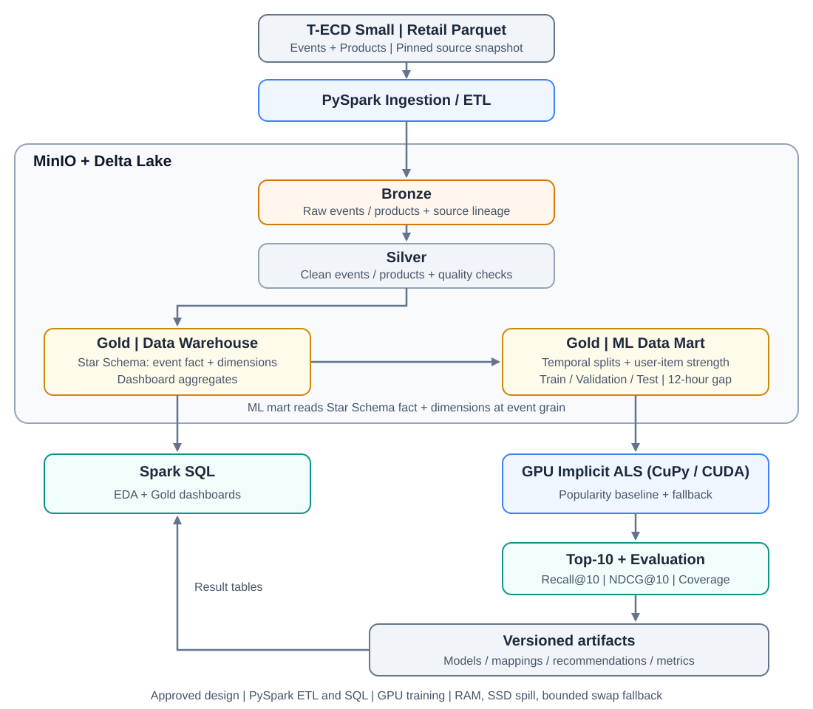

# ĐỀ CƯƠNG TIỂU LUẬN THẠC SĨ

**Môn học:** Khai phá dữ liệu lớn (Big Data Mining)
**Học viên:** Nguyễn Hoàng Vũ Thân — **Mã học viên:** 8282548015 — **Lớp:** KHDL28B
**Giảng viên:** TS. Trần Thiên Thành

**Tên đề tài:** **Ứng dụng kiến trúc Delta Lake và Apache Spark trong xử lý dữ liệu lớn và xây dựng hệ thống gợi ý sản phẩm**
*Tên tiếng Anh: Building a Product Recommendation System Using Delta Lake and Apache Spark*

**Sản phẩm nộp:** notebook `tieu_luan_retail_als.ipynb` đã chạy trên toàn bộ dữ liệu Retail, gồm nội dung
tiểu luận (Markdown), mã PySpark/Spark SQL, bảng, biểu đồ và nhận xét. Đề cương này quy định nội dung
từng phần để hoàn thiện notebook thành bài tiểu luận; chi tiết kỹ thuật và cách chạy nằm ở `AGENTS.md`.

---

## 1. Giới thiệu đề tài

Hệ thống gợi ý giúp người dùng tìm sản phẩm phù hợp từ lịch sử tương tác. Đề tài xây dựng quy trình xử lý
batch cho dữ liệu tương tác bán lẻ: Apache Spark làm sạch và tổ chức dữ liệu theo kiến trúc Medallion trên
Delta Lake (lưu trên MinIO); lớp Gold gồm kho dữ liệu Star Schema cho phân tích và ML Data Mart cho mô hình.
Mô hình khai phá chính là **Implicit Alternating Least Squares (ALS)** chạy trên GPU (CuPy/CUDA), đối chứng
với **Popularity Baseline**. Kết quả là danh sách Top-10 sản phẩm cho mỗi người dùng, được đánh giá theo
giao thức thời gian và phát hành theo phiên bản.

## 2. Mục tiêu và phạm vi

### 2.1. Mục tiêu

1. Thu nhận, làm sạch và biến đổi dữ liệu bằng PySpark và Spark SQL.
2. Lưu Bronze, Silver, Gold bằng Delta Lake trên MinIO; kiểm chứng nạp lại, lịch sử, phiên bản và schema.
3. Tổ chức Gold Data Warehouse theo Star Schema cho phân tích, Gold ML Data Mart cho học máy.
4. Triển khai Implicit ALS trên GPU và Popularity Baseline (đồng thời là fallback).
5. Đánh giá chất lượng gợi ý và đo thời gian, tài nguyên của pipeline một cách có thể tái lập.

### 2.2. Phạm vi

- **Dữ liệu:** T-ECD Small, chỉ miền Retail (`dataset/small/retail/`), revision `79bcf78`.
- **Bài toán:** xếp hạng Top-N từ implicit feedback, xử lý batch.
- **Lưu trữ:** Delta Lake trên MinIO; không dùng hệ quản trị Data Warehouse riêng.
- **Tính toán:** Spark local (CPU) cho ETL/SQL; một GPU NVIDIA cho ALS.
- **Giới hạn kết luận:** chỉ áp dụng cho dữ liệu Retail và tài nguyên đã đo trên một máy;
  không suy rộng sang cụm nhiều máy hay quy mô chưa chạy.

## 3. Bộ dữ liệu

| Thông tin | Giá trị |
|---|---:|
| File sự kiện / khoảng ngày tương đối | 227 / 1082–1308 |
| Số sự kiện | 267.043.972 |
| User / item có sự kiện | 140.062 / 257.327 |
| Catalog sản phẩm | 250.856 item |
| Dung lượng Parquet nguồn | khoảng 2,13 GB |
| Hành vi | `view` (94,9%), `order`, `added_to_cart`, `click` |

Trường sự kiện: thời gian tương đối (micro giây), `user_id`, `item_id`, `action_type`, `os`, `subdomain`.
Catalog: `brand_id`, `category`, `subcategory`, `price`. Đặc điểm cần trình bày: 8.521 item có sự kiện nhưng
thiếu catalog; một phần catalog thiếu category hoặc có giá âm/null (chưa rõ đơn vị nên không tính doanh thu);
không có mã đơn hàng hay số lượng; thời gian chỉ là tọa độ tương đối.

Nguồn: [T-ECD](https://huggingface.co/datasets/t-tech/T-ECD),
[thư mục Retail](https://huggingface.co/datasets/t-tech/T-ECD/tree/main/dataset/small/retail).

## 4. Kiến trúc hệ thống

| Thành phần | Vai trò |
|---|---|
| Bronze | Sự kiện và catalog gốc, metadata nguồn; nạp theo ngày, nạp lại không nhân đôi |
| Silver | Sự kiện và sản phẩm sạch, kiểu chuẩn, cờ thiếu dữ liệu, bảng quarantine |
| Gold Data Warehouse | Star Schema: `fact_interactions` + `dim_user`, `dim_product`, `dim_day`, `dim_action`, `dim_context`; bảng tổng hợp dashboard bằng Spark SQL |
| Gold ML Data Mart | Đọc fact/dimension của Gold DWH theo mốc thời gian: nhãn, bảng cặp user–item, rút gọn dữ liệu train, ánh xạ ID, strength, popularity, EDA train |
| GPU Implicit ALS, Popularity | Sinh Top-10, đánh giá, phát hành `gold.recommendations` |
| Kết quả có phiên bản | Model, mapping, gợi ý, chỉ số, hiệu năng; dashboard đọc lại |

Luồng: **Nguồn → Bronze → Silver → Gold DWH → Gold ML → ALS/Popularity → Top-10 và đánh giá**.
Hai nhóm Gold cùng một lớp, cùng là Delta trên MinIO. Medallion và Gold DWH giữ đủ dữ liệu; việc giảm kích
thước dữ liệu chỉ xảy ra ở Gold ML, sau EDA train.

## 5. Phương pháp

### 5.1. Medallion và kiểm chứng Delta Lake

Trình bày quy tắc từng lớp và năm kiểm tra Delta (bảng đạt/không đạt): nạp lại cùng ngày không nhân đôi,
đọc lại theo `versionAsOf`, `DESCRIBE HISTORY`, ghi sai schema bị từ chối, khóa bản ghi ổn định khi nạp lại.

### 5.2. Star Schema

Fact ở grain một sự kiện; dimension có khóa thay thế duy nhất. Item thiếu catalog có member Unknown riêng,
không gộp chung. Kiểm tra: số dòng fact bằng Silver, khóa dimension duy nhất. Giải thích vì sao chọn Star
Schema (truy vấn/EDA đơn giản, ít join) thay vì Snowflake.

### 5.3. Gold ML Data Mart và rút gọn dữ liệu train

- Chia theo thời gian trước khi tổng hợp: test 14 ngày cuối, validation 14 ngày trước đó, lịch sử kết thúc
  trước mỗi cửa sổ ít nhất 12 giờ (theo yêu cầu của T-ECD).
- Gom sự kiện thành bảng cặp user–item với số lần từng hành vi.
- **Rút gọn:** bỏ cặp chỉ có `view` dưới 2 lần; giữ mọi cặp có click/added_to_cart/order. Lý do: thời gian
  fit ALS tỉ lệ với số cặp khác 0; trên train toàn bộ Retail, 58% số cặp chỉ có đúng một lượt xem.
  Ngưỡng được chọn từ bảng EDA train (số cặp/user/item còn lại theo ngưỡng 1–5).
- Strength = tổng trọng số × số sự kiện theo hai profile: `uniform` và `purchase_focused` (1/2/3/5).

### 5.4. Implicit ALS

Với strength $r_{ui}$, sở thích $p_{ui}=\mathbb{1}[r_{ui}>0]$, confidence $c_{ui}=1+\alpha r_{ui}$:

$$\min_{X,Y}\sum_{u,i}c_{ui}(p_{ui}-x_u^Ty_i)^2+\lambda\left(\sum_u\|x_u\|^2+\sum_i\|y_i\|^2\right).$$

ALS luân phiên tối ưu nhân tố user và item; điểm $x_u^Ty_i$ dùng để xếp hạng, không phải xác suất mua.
Backend CUDA giải từng bước bằng conjugate gradient với regularization constant L2. Tham số khảo sát:
`rank`, `regParam`, `alpha`; cố định `maxIter=10`, seed 42. Đề tài áp dụng ALS, không đề xuất thuật toán mới.

### 5.5. Popularity Baseline

Điểm của item là số sự kiện `order` trong lịch sử được phép dùng; hòa điểm xếp theo index item. Dùng cùng
user, nhãn và quy tắc ứng viên như ALS; đồng thời là gợi ý cho user không có lịch sử.

## 6. Câu hỏi nghiên cứu

- **RQ1:** Implicit ALS có cho kết quả gợi ý tốt hơn Popularity Baseline không?
- **RQ2:** Tham số ALS và trọng số hành vi ảnh hưởng thế nào tới chất lượng gợi ý và thời gian huấn luyện?
- **RQ3:** Pipeline xử lý toàn bộ Retail tốn bao nhiêu thời gian và tài nguyên ở từng giai đoạn?

## 7. Thiết kế thực nghiệm

| Thực nghiệm | Nội dung | Kết quả báo cáo |
|---|---|---|
| E2 | 16 cấu hình ALS (2 profile × rank {32, 64} × regParam {0,05; 0,1} × alpha {10, 40}) trên validation | NDCG@10, Recall@10, thời gian fit; cấu hình được chọn theo NDCG@10 |
| E1 | ALS (cấu hình đã khóa, huấn luyện lại một lần) và Popularity trên test | Recall@10, NDCG@10 theo hai giao thức; population, cold-start, coverage |
| Hiệu năng | Một lượt chạy toàn bộ Retail | Thời gian, đỉnh RAM/swap/VRAM, shuffle/spill theo giai đoạn |

### 7.1. Giao thức đánh giá

| Thành phần | Quy tắc |
|---|---|
| Nhãn | Cặp user–item có `order` trong cửa sổ đánh giá; mỗi item tính một lần cho mỗi user |
| Train / validation / refit / test | Fit và chọn trên train/validation; huấn luyện lại trên lịch sử trước test; test chỉ dùng một lần |
| Ứng viên | Toàn bộ item trong lịch sử được dùng; không lấy mẫu ứng viên |
| Giao thức chính | Cho phép gợi ý lại item đã mua (mua lặp phổ biến trong bán lẻ) |
| Giao thức phụ | Loại item user đã thấy (theo lịch sử đầy đủ) khỏi cả ứng viên và nhãn |
| User đủ điều kiện | Có nhãn trong cửa sổ và có lịch sử trong mô hình |
| Cold-start | User không có lịch sử (hoặc mất hết cặp sau rút gọn) báo riêng, đánh giá bằng Popularity |
| Chỉ số | Recall@10, NDCG@10 (relevance nhị phân), trung bình theo user |

### 7.2. Đo hiệu năng

Mỗi giai đoạn ghi thời gian lần hoàn tất, số lần thử, đỉnh RAM/swap của job, VRAM, shuffle và spill của
Spark. Đây là một lần đo trên một máy (giới hạn RAM 7 GiB, swap 4 GiB): không có trung vị hay khoảng dao
động, không suy ra quan hệ thời gian–quy mô. Bổ sung ảnh Spark UI thật của giai đoạn nặng.

## 8. Bố cục notebook

Mỗi bước thực hành theo cấu trúc **Mục đích → Code → Kết quả → Nhận xét**: Markdown nêu bước giải quyết việc
gì và vì sao; mỗi code cell làm một việc; output giới hạn số dòng; Markdown sau output giải thích số liệu và
ảnh hưởng tới bước sau.

| Phần | Nội dung Markdown | Code và kết quả |
|---|---|---|
| **0. Thông tin và tóm tắt** | Thông tin học viên, tóm tắt, mục lục | Tóm tắt điền số liệu thật sau lượt chạy |
| **1. Bài toán, mục tiêu, phạm vi** | Bài toán Top-N, mục tiêu, RQ1–RQ3 | Không có code |
| **2. Cơ sở phương pháp và kiến trúc** | Spark, Delta, MinIO, Medallion, hai nhóm Gold, rút gọn ở Gold ML, ALS, Popularity; sơ đồ | Không có code |
| **3. Môi trường và cấu hình** | Phiên bản, giới hạn tài nguyên, checkpoint, cách chạy | Cấu hình, khởi tạo Spark, kiểm tra MinIO, bảng môi trường |
| **4. Dữ liệu nguồn và khảo sát** | Nguồn, revision, schema, ý nghĩa trường | Manifest, thống kê sự kiện/user/item/hành vi/OS/subdomain |
| **5. Bronze** | Giữ dữ liệu gốc, lineage, nạp theo ngày | Ghi Bronze; năm kiểm tra Delta |
| **6. Silver** | Quy tắc làm sạch, quarantine, cờ chất lượng | Bảng số dòng và chất lượng |
| **7. Gold Data Warehouse** | Star Schema, kiểm tra khóa, câu hỏi phân tích | Dimension, fact; 10 bảng Spark SQL; biểu đồ dashboard |
| **8. Gold ML Data Mart** | Giao thức, chia thời gian, rút gọn, EDA train | Nhãn, bảng cặp, bảng ngưỡng rút gọn, index, strength, popularity; population |
| **9. Popularity Baseline** | Định nghĩa điểm, hàm chỉ số | Ví dụ kiểm tra hàm chỉ số; Popularity trên validation |
| **10. ALS — E2** | Lưới tham số, tiêu chí chọn | 16 cấu hình; bảng, biểu đồ; khóa lựa chọn |
| **11. Đánh giá cuối — E1** | Refit, hai giao thức, cold-start | Bảng/biểu đồ E1; ví dụ Top-10; phát hành `gold.recommendations` và artifact |
| **12. Hiệu năng lượt chạy toàn bộ Retail** | Cách đo, giới hạn của một lần đo | Bảng và biểu đồ theo giai đoạn; ảnh Spark UI |
| **13. Thảo luận và kết luận** | Trả lời RQ1–RQ3, giới hạn, hướng phát triển | Bảng tổng hợp từ kết quả đã lưu |
| **14. Tài liệu tham khảo và tái lập** | Nguồn, tài liệu đi kèm, quy trình tái lập, đầu ra | Trạng thái các giai đoạn, hồ sơ chạy |

## 9. Nội dung cần viết sau khi chạy toàn bộ Retail

1. **Phần 0:** tóm tắt bằng số thật: số sự kiện, kết quả E1 (ALS so với Popularity), cấu hình được chọn,
   tổng thời gian chạy.
2. **Phần 4–7:** nhận xét phân bố hành vi, long-tail user/item, thiếu catalog, OS/subdomain.
3. **Phần 8:** số cặp/user/item trước và sau rút gọn; số user mất lịch sử; số nhãn validation/test.
4. **Phần 10 (RQ2):** so sánh các cặp cấu hình chỉ khác một tham số trong cùng profile; ảnh hưởng của rank
   lên thời gian fit.
5. **Phần 11 (RQ1):** chênh lệch ALS – Popularity theo từng giao thức, kèm population; nếu ALS thấp hơn,
   nêu giả thuyết (mua lặp, độ thưa, trọng số) và ghi rõ là giả thuyết.
6. **Phần 12 (RQ3):** giai đoạn tốn thời gian nhất, đỉnh bộ nhớ, spill; ảnh Spark UI.
7. **Phần 13:** kết luận theo RQ, giới hạn (một máy, một lần đo, dữ liệu ẩn danh, thời gian tương đối,
   catalog không có lịch sử hiệu lực), hướng phát triển (cold-start dùng thuộc tính sản phẩm, đánh giá nhiều
   mốc thời gian, cụm nhiều máy).

## 10. Quy tắc hoàn thiện và nộp

- Chạy `./run_notebook.sh` trên toàn bộ Retail; notebook có output nằm ở
  `results/<RUN_ID>/execution/latest.ipynb`. Nộp bản có output này sau khi bổ sung nhận xét.
- Không viết kết quả dự kiến như kết quả thực tế; mọi con số trong Markdown phải có trong output.
- Không chỉnh tham số sau khi xem test; muốn thay đổi giao thức phải dùng RUN_ID mới và chạy lại toàn bộ.
- Không lưu khóa MinIO trong cell hoặc output.
- Trước khi nộp: kiểm tra mục lục, liên kết, sơ đồ, công thức, bảng, biểu đồ và thứ tự cell.

## 11. Tài liệu tham khảo chính

1. T-Tech, T-ECD Dataset — <https://huggingface.co/datasets/t-tech/T-ECD>
2. Y. Hu, Y. Koren, C. Volinsky, *Collaborative Filtering for Implicit Feedback Datasets*, ICDM 2008 — <https://doi.org/10.1109/ICDM.2008.22>
3. Apache Spark, RankingMetrics (định nghĩa Recall/NDCG) — <https://spark.apache.org/docs/4.2.0/api/python/reference/api/pyspark.mllib.evaluation.RankingMetrics.html>
4. Delta Lake Documentation — <https://docs.delta.io/>
5. Databricks, Medallion Architecture — <https://docs.databricks.com/aws/en/lakehouse/medallion>
6. Apache Spark SQL Programming Guide — <https://spark.apache.org/docs/4.2.0/sql-programming-guide.html>
7. Apache Hadoop S3A — <https://hadoop.apache.org/docs/r3.5.0/hadoop-aws/tools/hadoop-aws/index.html>
